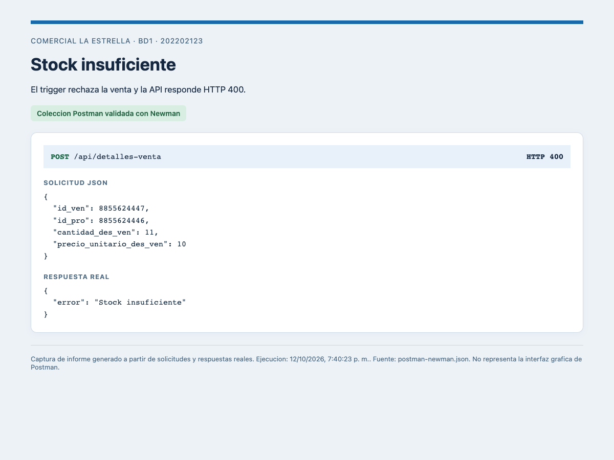
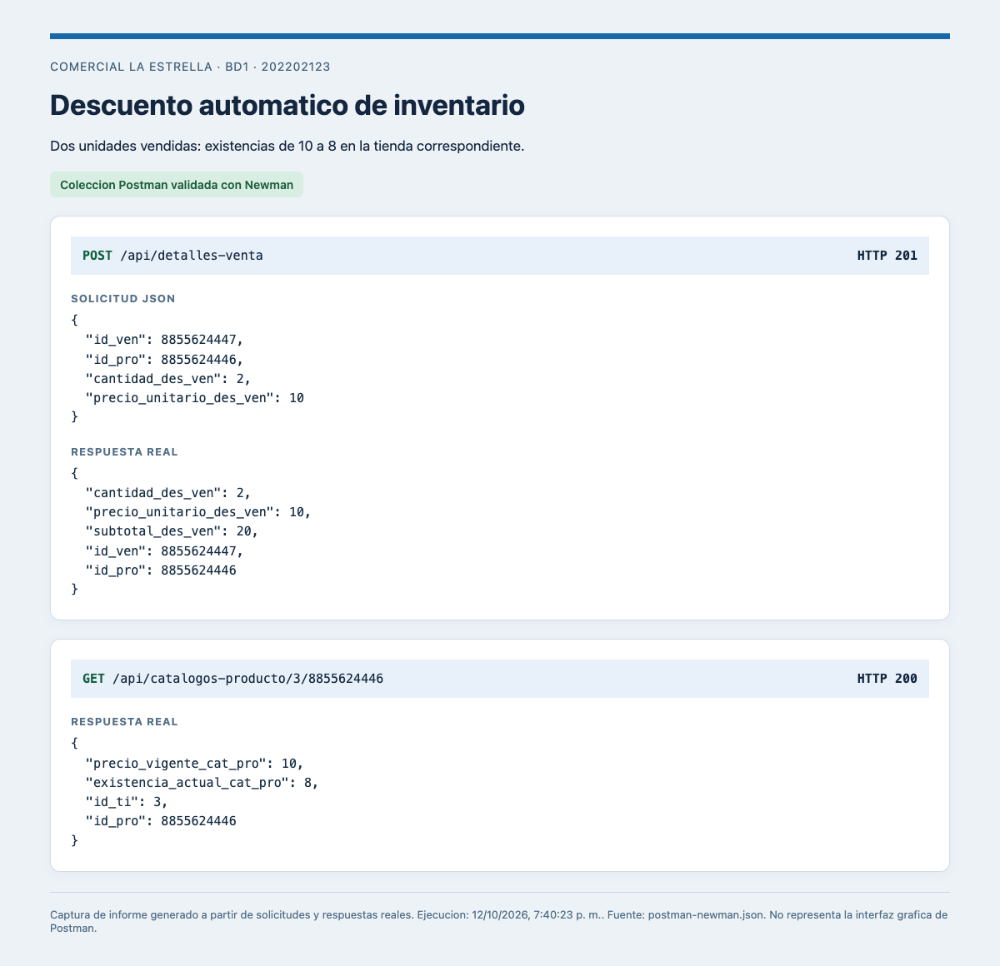
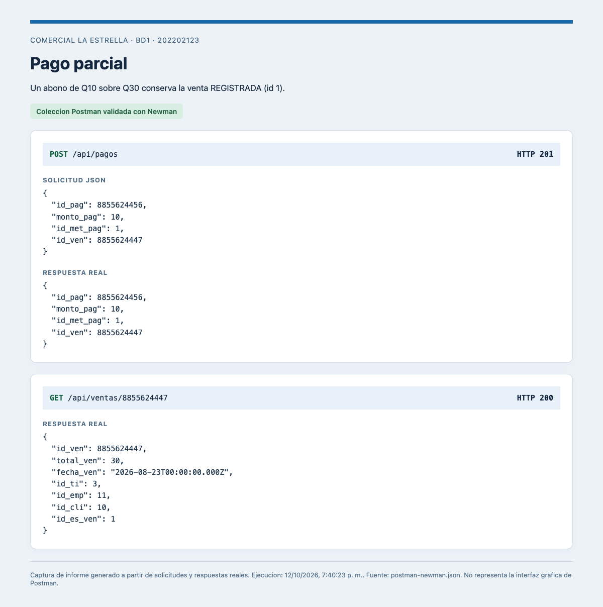
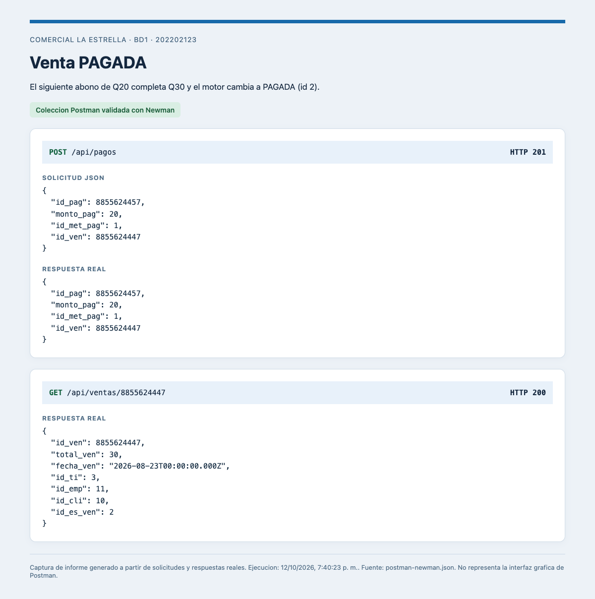

# Evidencias de ejecucion

Pruebas realizadas el **12 de octubre de 2026**, hora de Guatemala. Los archivos JSON originales guardan marcas de tiempo UTC.

## Resultados

- Carga original: **19 tablas, 9068 registros**, con estados de venta iguales a la Fase 1.
- Integracion: **160 peticiones verificadas**, incluidas compras realmente simultaneas y lotes atomicos.
- Postman/Newman: **161 peticiones, 402 aserciones, cero fallos**. La diferencia de una peticion corresponde a representar dos POST concurrentes como dos solicitudes secuenciales en Runner.
- Postman v3 YAML: **161 peticiones, 402 aserciones, cero fallos**, comprobado el 13 de octubre de 2026 con el CLI oficial.
- Reportes: montos, conteos, cantidades, ubicaciones y saldos coinciden con un calculo independiente a partir de respuestas HTTP.
- Permisos: usuario de consulta sin INSERT/UPDATE/DELETE; usuario de API sin CREATE TABLE.

Las pruebas agregan registros de demostracion con IDs nuevos. Los conteos de `carga-datos.json` corresponden a la carga inicial; los reportes posteriores tambien incluyen ventas de demostracion que sigan vigentes.

## Capturas

Estas son capturas del informe generado desde las respuestas reales de Newman. No se simula la interfaz grafica de Postman. Los HTML correspondientes permiten inspeccionar el contenido de cada imagen.

### Stock insuficiente



### Descuento de inventario



### Abono parcial



### Venta pagada



## Fuentes de evidencia

| Archivo | Contenido |
|---|---|
| `carga-datos.json` | Conteos de todas las tablas y comprobacion de estados |
| `verificacion-api.json` | Peticiones, cuerpos, respuestas y prueba concurrente |
| `postman-newman.json` | Resultado completo del runner de Postman |
| `postman-newman.txt` | Salida del runner con el resumen de cero fallos |
| `postman-v3.txt` | Ejecucion de la coleccion YAML v3 con cero fallos |
| `postman-resumen.json` | Conteos y lista de fallos vacia |
| `reportes.json` | Comparacion independiente de los tres reportes |
| `estructura-permisos.json` | Tablas, vistas, triggers y permisos verificados |

## Regenerar

Con los servicios iniciados y el dataset cargado:

```bash
npm run verificar
npm run verificar:reportes
npx --yes newman run postman-json/ComercialLaEstrella.postman_collection.json --reporters cli,json --reporter-json-export docs/evidencias/postman-newman.json > docs/evidencias/postman-newman.txt 2>&1
npm run evidencias
```

El renderizador usa Google Chrome si esta instalado en macOS; en otros equipos puede requerir `npx playwright install chromium`. No es necesario regenerar las capturas para ejecutar o evaluar la API.
